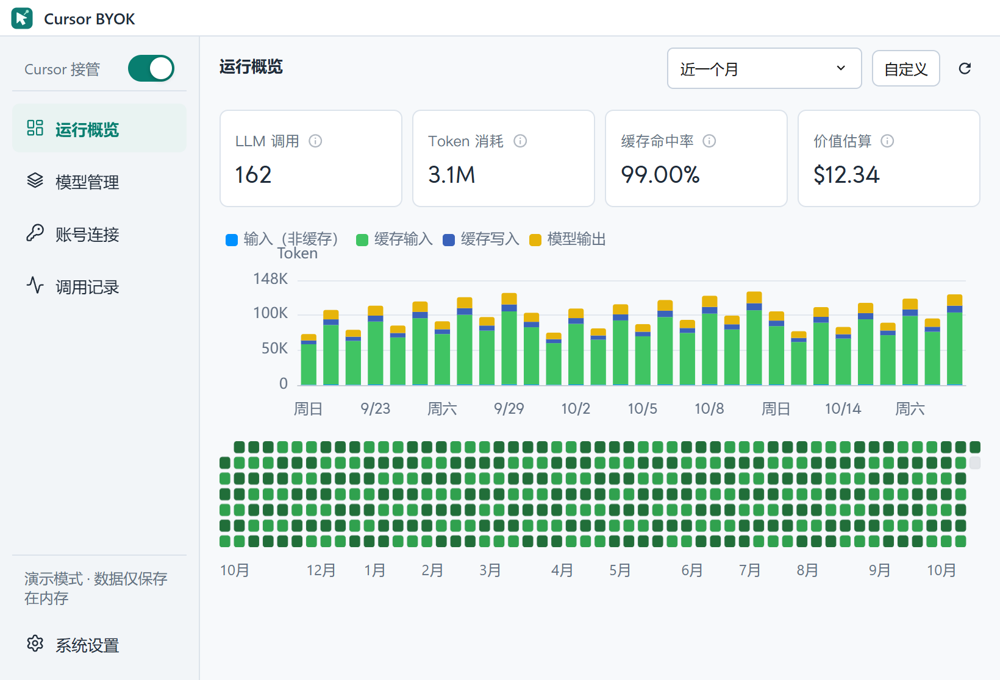
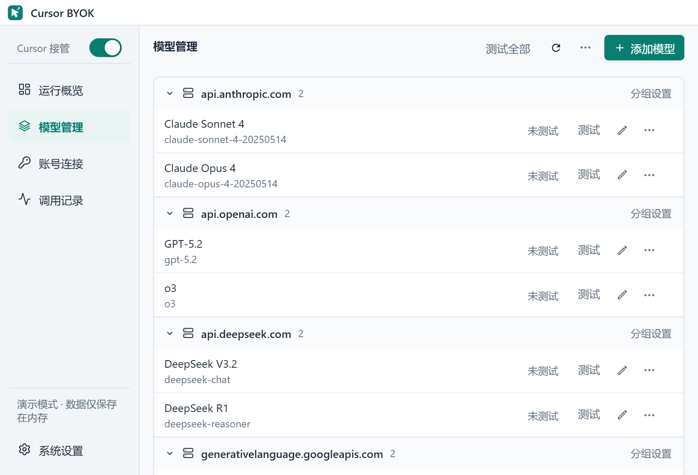
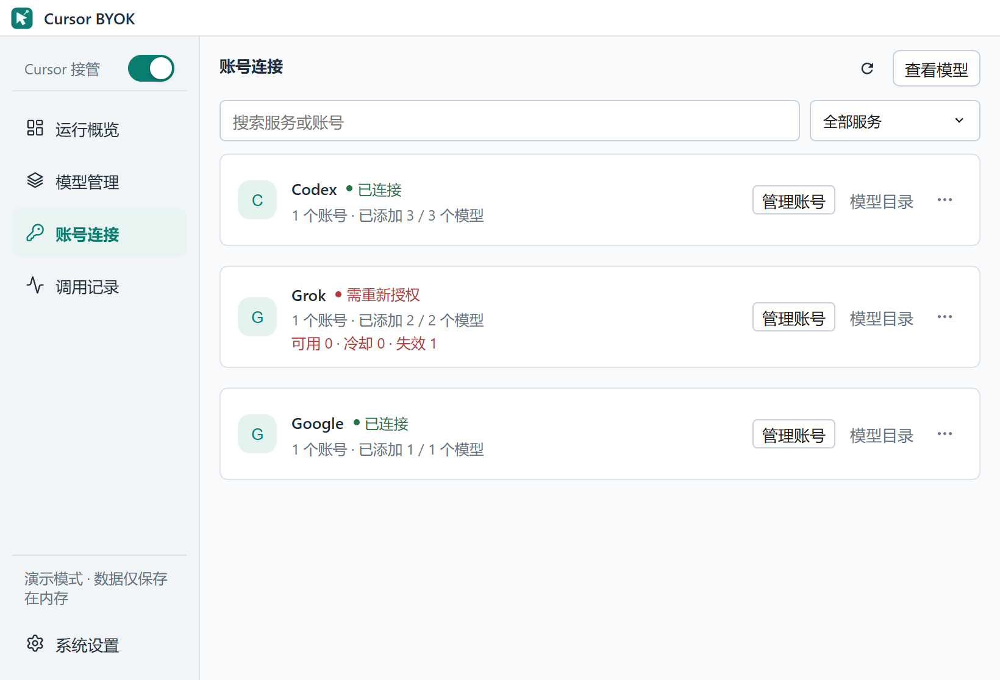

<div align="center">


# Cursor BYOK

在 Cursor 中使用自己的模型服务，并在本地管理模型、账号与调用记录。

[English](./README.md) · [下载安装](https://github.com/Quiyyy/cursor-byok/releases) · [维护与开发](./MAINTAINING.md) · [问题反馈](https://github.com/Quiyyy/cursor-byok/issues)

[](https://github.com/Quiyyy/cursor-byok/actions/workflows/ci.yml)
[](./LICENSE)

</div>

Cursor BYOK 是一个本地模型网关与桌面管理工具。应用在本机运行 Rust 服务，将 Cursor 的请求接入你配置的模型 API 或账号通道。

项目的开发、文档、问题跟踪和版本发布统一由 **[Quiyyy/cursor-byok](https://github.com/Quiyyy/cursor-byok)** 维护。



## 主要功能

- **模型接入**：支持 OpenAI Responses、OpenAI Chat Completions 和 Anthropic Messages 兼容接口，可配置请求头、思考参数与额外参数。
- **账号连接**：内置 Codex、Grok 和 Google 接入，支持模型同步、账号状态展示与可用凭据的自动续期。
- **模型管理**：添加、编辑、复制草稿、分组、排序及连通性测试；配置和测试无需先开启 Cursor 接管。
- **全局接管开关**：左上角直接开启或关闭 Cursor 本地集成。首次开启前需完成证书准备；关闭时清理应用管理的本地代理配置。
- **用量与诊断**：查看调用记录、Token 用量、缓存统计、估算价值及每日活动。
- **跨平台桌面**：支持 Windows、macOS、Linux，中英葡三种语言，以及浅色、深色主题。

模型请求会发送至你选择的服务商，费用与账号权限由对应服务商决定。本项目独立维护，与 Cursor 没有官方隶属关系。

## 快速开始

1. 从 [Releases](https://github.com/Quiyyy/cursor-byok/releases) 下载对应平台的安装包。
2. 打开 **模型管理 → 添加模型**，填写服务地址、API Key 和模型名称；也可在 **账号连接** 中登录，再从模型目录勾选需要的模型并保存。
3. 保存模型并运行 **测试**，确认连接可用。
4. 打开左上角 **Cursor 接管**。若出现证书准备提示，按应用指引完成安装和信任，刷新状态后再开启开关。
5. 保持 Cursor BYOK 运行。首次配置完成后，完全退出并重新启动 Cursor，新建对话，手动选择已配置的模型；**Auto 不会选择 BYOK 模型**。

详细步骤和常见问题见[使用指南](./docs/GETTING_STARTED.md)。已有安装若使用不同更新通道，需先手动安装本仓库的版本，再使用应用内更新。

截图来自当前源码的演示模式，数据均为示例；已发布安装包的界面可能早于当前源码。

## 模型与账号



点击模型名称或编辑按钮即可配置模型。常用操作保留在列表中，分组与排序方式收在页面右上角 **⋯**。高级参数按需展开。



账号与模型目录共用一个管理弹窗，模型选择在保存后生效。服务商撤销的授权需要重新登录。

## 请求路径

```text
Cursor → 本地接管 → Cursor 协议适配 → 运行时
                                      │
                                      ├─ 自定义模型 API
                                      └─ 账号插件 → 服务商 API
                                      │
Cursor ← 流式响应、工具调用与结果 ←─────┘
```

配置、账号数据和调用记录保存在本机。TAB 补全默认官方直连，也可填写自定义服务地址，与聊天模型分开处理。

当前源码从本机已安装的 Cursor 加载提示词、工具定义及上层工具实现，通过统一桥接承载官方工厂生成的模型差异。BYOK 保留模型循环与检查点；文件替换、Notebook 编辑由原生工具实现，底层文件、终端、交互和 MCP 执行交给 Cursor 客户端。构建与验证见[原生运行时维护](./support/cursor-assets-extractor/README.md)。

## 文档入口

| 文档 | 用途 |
| --- | --- |
| [使用指南](./docs/GETTING_STARTED.md) | 安装、模型配置、接管与排障 |
| [维护与开发](./MAINTAINING.md) | 开发命令、检查、隔离调试与发布 |
| [架构说明](./docs/ARCHITECTURE.md) | 目录职责、运行时边界与数据流 |
| [维护状态](./docs/MAINTENANCE_STATUS.md) | 已验证修复及待验收事项 |
| [资产说明](./docs/ASSETS.md) | 图标、截图、字体及更新方式 |
| [第三方说明](./docs/THIRD_PARTY.md) | 依赖来源与许可边界 |

## 参与维护

通过本仓库的 [Issues](https://github.com/Quiyyy/cursor-byok/issues) 和 [Pull Requests](https://github.com/Quiyyy/cursor-byok/pulls) 反馈与贡献。问题报告请附应用版本、操作系统、复现步骤及脱敏错误信息，不要公开 API Key、账号凭据或私有源码。

提交代码前阅读 [AGENTS.md](./AGENTS.md) 和[维护说明](./MAINTAINING.md)。合并 PR 不会自动发布新版本。

## 许可证

采用 [MIT License](./LICENSE)。现有版权声明与 Git 作者历史保持完整。
