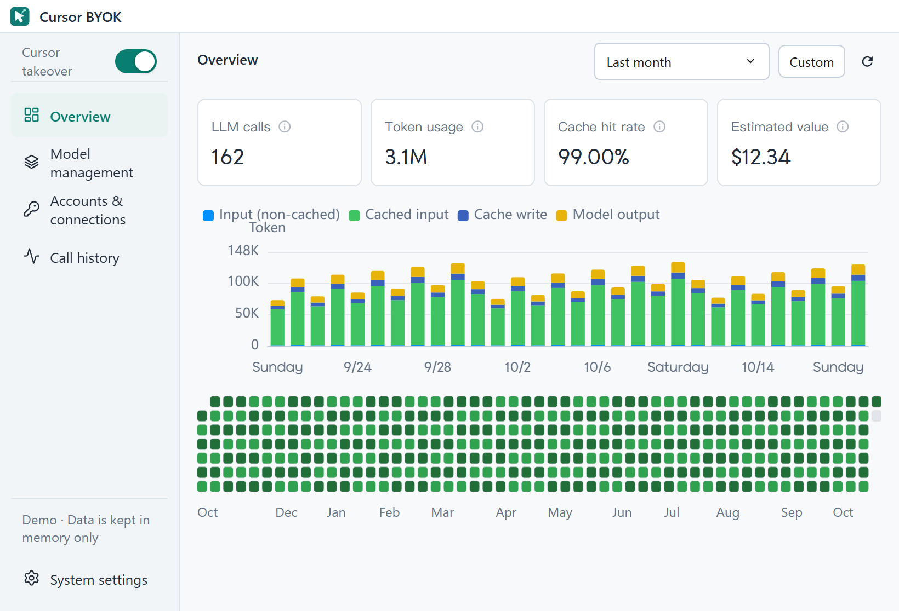
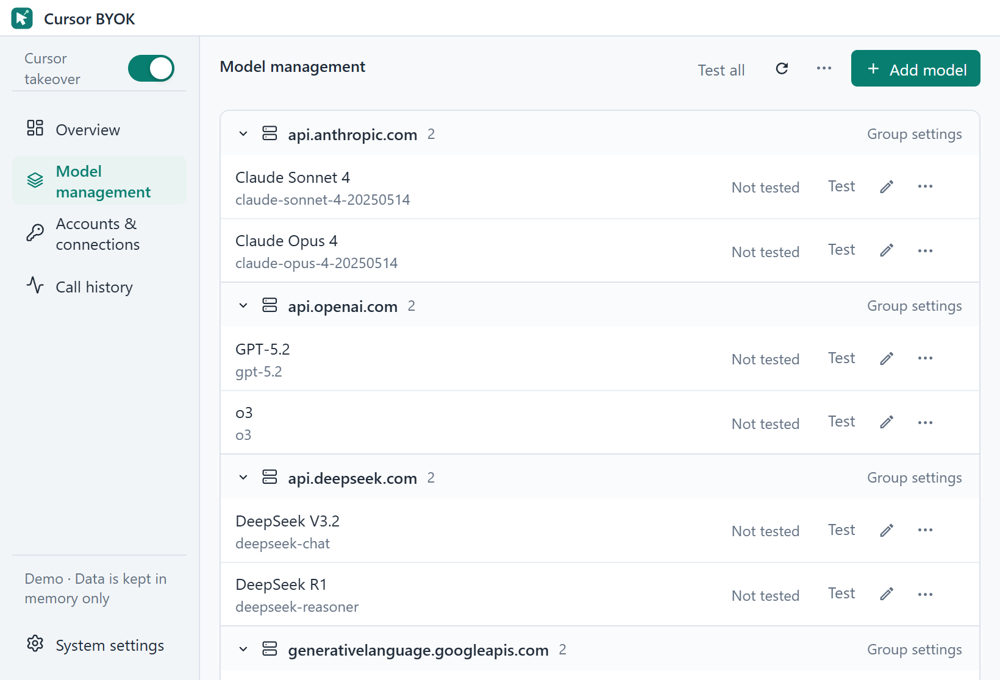
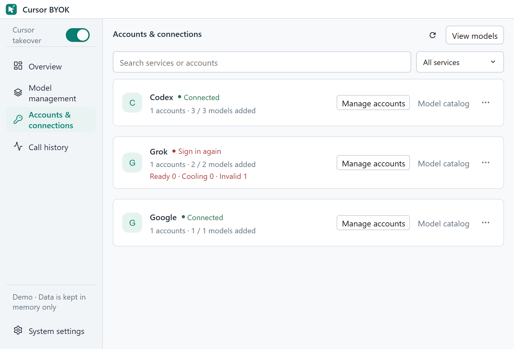

<div align="center">


# Cursor BYOK

A local model gateway and desktop manager for Cursor.

[中文](./README-CN.md) · [Download](https://github.com/Quiyyy/cursor-byok/releases) · [Development](./MAINTAINING.md) · [Issues](https://github.com/Quiyyy/cursor-byok/issues)

[](https://github.com/Quiyyy/cursor-byok/actions/workflows/ci.yml)
[](./LICENSE)

</div>

Cursor BYOK connects Cursor to the model APIs and accounts you configure. The desktop app manages models, account connections, request history, and usage through a local Rust service.

Development, documentation, issues, and releases are maintained in **[Quiyyy/cursor-byok](https://github.com/Quiyyy/cursor-byok)**.



## Features

- **Model connections:** OpenAI Responses, OpenAI Chat Completions, and Anthropic Messages compatible endpoints; custom headers, reasoning settings, and request parameters.
- **Account connections:** built-in Codex, Grok, and Google integrations, model synchronization, account status, and credential renewal where supported.
- **Model management:** add, edit, duplicate into a draft, group, reorder, and test models. Model configuration and tests do not require enabling Cursor takeover.
- **Cursor takeover:** a global sidebar switch controls the local integration. Enable it after completing certificate preparation; switching it off removes the managed local proxy configuration.
- **Usage and diagnostics:** call history, token usage, cache statistics, estimated cost, and daily activity.
- **Desktop app:** Windows, macOS, and Linux; Chinese, English, and Portuguese; light and dark themes.

Model requests go to the providers you choose. Model API charges and account permissions are determined by those providers. Cursor BYOK is an independent project and is not affiliated with Cursor.

## Quick start

1. Download the appropriate package from [Releases](https://github.com/Quiyyy/cursor-byok/releases).
2. Open **Model management → Add model** to configure an API endpoint, key, and model ID, or open **Accounts & connections** to connect an account and select models in its catalog.
3. Save and test the model. For account-based models, save the catalog selection so they appear in Model management.
4. Turn on **Cursor takeover** in the upper-left corner. If certificate preparation is required, follow the application’s instructions, refresh its status, then enable takeover.
5. Keep Cursor BYOK running. Fully restart Cursor after the initial setup, open a new conversation, and select the configured model. Cursor’s **Auto** option does not select your BYOK models.

Updates are distributed through this repository’s releases. If an existing installation uses another update channel, install a package from this repository once before relying on in-app updates.

The screenshots show the current source tree in demonstration mode; released packages may have an earlier interface. All screenshot data is synthetic.

## Models and accounts



Model names can be edited directly. Common operations remain in the row; grouping and ordering options are available in the page’s **⋯** menu. Advanced model parameters are collapsed by default.



Account management and the model catalog share one dialog. Catalog selections take effect when saved. Credentials that have been revoked by a provider require signing in again.

## How requests flow

```text
Cursor → local integration → Cursor protocol adapter → runtime
                                                      │
                                                      ├─ configured model API
                                                      └─ account plugin → provider API
                                                      │
Cursor ← streaming responses and tool events ←─────────┘
```

Settings, account data, and request records are stored locally. TAB completion connects directly to Cursor’s official service by default, with an optional custom service address. It is separate from the chat models.

BYOK runs the model/tool loop while Cursor executes client tools. The current source loads prompts, tool schemas, and upper-level tool implementations from the installed Cursor runtime. One bridge supports the model-specific contracts generated by Cursor; it no longer reimplements file replacement or notebook editing. MCP definitions and execution come from Cursor. See the [asset extractor](./support/cursor-assets-extractor/README.md) for provenance, updates, and local verification.

## Documentation

| Document | Purpose |
| --- | --- |
| [Getting started](./docs/GETTING_STARTED.md) | Setup, model configuration, takeover, and troubleshooting (Chinese) |
| [Maintenance](./MAINTAINING.md) | Development, checks, isolated UI debugging, and releases |
| [Architecture](./docs/ARCHITECTURE.md) | Directories, runtime ownership, and data flow |
| [Maintenance status](./docs/MAINTENANCE_STATUS.md) | Verified fixes and remaining validation work |
| [Assets](./docs/ASSETS.md) | Icons, screenshots, fonts, and asset update rules |
| [Third-party notices](./docs/THIRD_PARTY.md) | Dependency provenance and license boundaries |

## Contributing

Use this repository’s [Issues](https://github.com/Quiyyy/cursor-byok/issues) and [Pull Requests](https://github.com/Quiyyy/cursor-byok/pulls). Include the application version, operating system, and a minimal reproduction. Remove API keys, account credentials, and private source code from reports.

Read [AGENTS.md](./AGENTS.md) and [MAINTAINING.md](./MAINTAINING.md) before changing code. Merging a pull request does not publish a release.

## License

[MIT](./LICENSE). Existing copyright notices and Git authorship remain intact.
